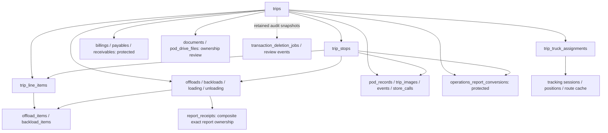

# Phase 2C ? October 18, 2026 checkpoint

> Latest: [Phase 2C.1 SQL/deletion review](phase-2c1-sql-deletion-review.md) supersedes the Tracker-only removal blocker and the old whole-trip proposal checksum. Both reports now share parent-trip deletion. A separate driver-update FK proposal is required. Live deletion remains disabled.

## Safety and scope

Existing work was preserved; the initial index/worktree was clean and contained no unresolved entries. Supabase inspection was SELECT-only against `hdmknewarynwpbrhfgai`. No live migration, operational mutation, deletion, coordinate edit, publication/Storage/Auth change, paid Directions/Gemini request, GPS capture, commit, push or deployment was performed. The already-applied planned migration `20261017124148` was not reapplied.

`TRACKING_ENABLED=false`, `POD_PDF_ENABLED=false`, `POD_REVIEW_ENABLED=true`; `PLANNED_ROUTES_ENABLED` remains unset, whose application default is false. New `WHOLE_TRIP_DELETE_ENABLED` is unset/default false. No feature activation is implied by this checkpoint.

## Phase 0 architecture and baseline

- React Dashboard selects Home/Trips/Reports. Previously the keyed content shell rebuilt feature state; Tracker and Operations unmounted on internal navigation. Auth started a global 23-request preload. Flexible section metadata had an uncached spinner. Home walked all trip/report pages and launched event/image enrichment in parallel for every trip.
- Existing infrastructure reused: token-scoped API/report/page caches with in-flight deduplication and generation guards; composed screen snapshots; bounded background queue; canonical physical-cell persistence; shared width/design revisions; deferred draft-safe refresh; Socket.IO presence/commit metadata; Supabase secure change signals; existing private cleanup journals.
- Reports already have bounded server pagination, dataset-wide search/sort/filter and separate bounded exports. This phase does not replace those systems.
- Realtime uses minimal secure signals and authorized API refetching, plus canonical commit notifications. Hidden React Activity panels pause effects, presence and subscriptions, then reconcile on resume. No new publication or socket transport was added.
- Principal bottlenecks: unrelated login requests, discarded report state, repeated section-list reads, unbounded Home history/enrichment fan-out, large existing application/Mapbox/export bundles. The bundle-size warning remains; no broad bundler rewrite was attempted.

### Live ownership and deletion relationship graph (read-only)

The detailed FK inspection included all direct trip references and indirect stop, assignment, item, report and receipt references. Existing transaction RPC checks financial dependencies, conversion history, ambiguous/cross-owned receipts, documents and Drive files. Flex source rows use logical source identifiers and are explicitly reconciled by that RPC. Private Storage cleanup occurs only after DB commit, by exact owned keys. Review/audit identity metadata is retained. Existing unsupported Storage keys (including future PDF keys), protected history and attachments can still block deletion; these guards are not bypassed.

The existing transaction RPC deliberately rejects a null stop on a trip with stops. Existing `/trips/:id` deletion therefore cannot safely implement Combined's new whole-trip requirement. Tracker is a completed-stop projection, not a physical independently deletable report: removing a POD would leave the completed stop eligible and the row would reappear.

## Implemented phases and requirement status

| Requirement | Status | Evidence / limitation |
|---|---|---|
| 1. Per-tab one-load | Implemented for initial bounded datasets | Login initializes isolation only; Home, Trips and Reports independently warm their caches. Active report is first; background concurrency 2 tasks, maximum 4 HTTP calls for report tasks. Retained feature state and existing SWR caches are reused. |
| 2. Remove POD sidebar | Complete | Dedicated sidebar item removed. Existing POD routes, Trip Details review, APIs and notifications preserved. |
| 3. Smooth report transitions | Complete in isolated browser tests | Combined/Tracker/Operations retain search, state and scroll through React Activity. Hidden effects/presence stop. Literal section-loading text replaced by compact skeleton and cached section metadata. |
| 4. Tracker toolbar | Complete locally | Compact shared search/Column Finder and icon Edit beside it; existing server search unchanged. |
| 5. Combined whole-trip deletion | Prepared; blocked for live activation | Admin-only impact preview, deduplicated physical parent IDs, atomic SQL proposal, durable post-commit cleanup, disabled-by-default endpoint. SQL requires approval. |
| 6. Offload filters | Complete | All / Backload / Offload only. Loading/unloading APIs, records and other workflows remain. All still means all authorized Operations types. |
| 7. Original submitter attribution | Display complete; search/sort SQL pending | Offload hydration resolves `created_by`, then `submitted_by`; never substitutes delegated `reported_by`, driver or current editor. Unknown creator displays unavailable. Existing creator IDs and delegate metadata unchanged. Live view search/sort still needs proposal below. |
| 8. Compact report actions | Partial | Separate row-count panels removed. Offload Edit/Delete work on exact report IDs; disabled with no selection. Tracker Edit works; Delete visibly disabled with lifecycle explanation pending policy approval. |
| 9. Stepped report Edit Row | Implemented locally | Standard reports: Basic / Assignment / Delivery and supporting details; Operations: Basic / Assignment and Delivery / Supporting; Tracker: Delivery / Shipping and Supporting. Previous/Next/Save/Cancel; Save always available. Changed-only writes, state retained across steps, discard confirmation. Existing field-level save/version checks preserved. |
| 10. Trips Save any step | Complete locally | Existing four-step visual design retained; Save available throughout. Exact trip/stop/line-item mappings preserved. |
| 11. Unified Home map | Implemented with fixture verification | No Home map-mode buttons. Real cached planned or remaining geometry wins; otherwise ten isolated synthetic Philippine mock trips. No production/provider writes. |

### Home bounded loading limitation

Home now reads the latest 100 active trips and up to 500 monitoring rows instead of all history. Database counts supply complete totals; the UI identifies the latest-100 preview. Event/image requests use bounded queues (2 each, at most 4 combined), publish base content before enrichment and stop queued work when hidden. Historical charts/preview details are sampled, not all-time aggregates. A dedicated server summary API would be the next step if all-history chart aggregation is required. Trip/report exports remain unchanged. Home report enrichment now matches only physical parent trip IDs, preventing two trips with a shared dispatch label from receiving each other's assignment/route details; a dedicated regression test covers this.

### Editing semantics

Modal navigation never saves partial drafts. Save persists only changed fields through existing canonical write handlers. Existing report/Tracker row saves remain **field-by-field**, not all-fields atomic: a later failure can leave earlier confirmed fields saved; error feedback states this. Destructive whole-trip operations use one atomic DB call and have no independent-delete fallback. Realtime is deferred while editing/resizing. Unvisited or unchanged blank inputs are not converted to null.

## SQL proposals ? NOT applied

### Original Offload creator search/sort

- File: `backend/migrations/2026_11_06_proposed_operations_creator_attribution.sql`
- SHA-256: `FD644E23536967C313DD8E1FCAE319B50C7606D811E66C27D39597B96AD5F8CC`
- Replaces only the existing Operations pagination view's reporter projection to prefer authenticated creator, then submitter. Column contract, joins and pure sort helper remain compatible. No data backfill, new table, grants, RLS, Storage or publication change.
- Disposable PostgreSQL verifies 125 Offloads, creator search across pages and no invented historical attribution.
- Recovery: capture current `pg_get_viewdef` before separately approved install and restore that exact prior definition if needed; no data rollback is necessary.

### Atomic whole-trip deletion

- File: `backend/migrations/2026_11_07_proposed_whole_trip_deletion.sql`
- SHA-256: `F760738B3FBACD72A5C075FC0A3FA29150F793A6D49B6501DA308A0BC743959D`
- Adds only service-role `delete_whole_trips_v1(uuid[],uuid)`; public/anon/authenticated execution revoked. Admin profile validated again in SQL; fixed search path. No install-time operational writes. Reuses existing RPC retention checks and deletion jobs inside one outer transaction, ordered locking, deduplicated parents and retry acknowledgement.
- POST `/trips/whole-delete/impact` is Admin-only and read-only. POST `/trips/whole-delete` fails closed unless `WHOLE_TRIP_DELETE_ENABLED=true`; no unsafe fallback. Counts fail closed when unavailable.
- One protected record rolls back the entire selected trip batch, including earlier stop deletions and cleanup jobs. Storage is never removed before DB commit. Cleanup failure is reported as pending, retained durably and retried through existing authorized cleanup handling.
- Frontend confirmation shows dispatch, physical IDs, stop/item/POD/receipt/report/dependency counts and permanent cross-report warning. Cancel writes nothing; duplicate clicks cannot submit twice. No live deletion is available now.
- Recovery: leave/set `WHOLE_TRIP_DELETE_ENABLED=false` and restart backend. Drop only the new function under separate approval if schema rollback is needed. Retain journals/snapshots; SQL rollback cannot restore files already removed after a successful operational deletion. Production activation requires backups/recovery review and separate controlled acceptance approval.

### Tracker deletion blocker

A product/data-retention decision is needed: should removing a Tracker row mean hiding the completed stop from Tracker, deleting only tracker metadata, or altering completion eligibility? None is equivalent to deleting POD, stop or trip. No new tombstone schema or destructive endpoint was invented. The toolbar's disabled Delete explains this. Prepare a minimal proposal only after that lifecycle is confirmed.

## Map and coordinates

Read-only live counts: 7 warehouses (1 valid coordinate pair, 6 missing), 8 stores (8 valid, 0 missing), 6 active trip route contexts, 0 cached routes. Two active trips lack warehouse coordinates; none lack store coordinates. Coordinate-blocked trip IDs: `29b5b887-aaaf-4b76-9805-0604abd4092e`, `9fe51cf5-06ae-4703-96d1-0848d8f07ab3`.

Home reads cached planned geometry even while planned **generation** is disabled; if no usable planned geometry exists it can use an authorized remaining route. Marker updates reuse geometry and viewport. Existing warehouse editor remains preview-only, Save disabled. No SQL is needed to store coordinates because existing columns already exist; six warehouse locations require separate real-world verification and write approval.

The new demo provider contains ten explicitly synthetic trips in Metro Manila, Laguna and Cebu. The local polylines are hand-authored mock road-shaped geometry, **not verified Mapbox Directions output or navigation-quality real roads**. No synthetic distance/ETA or live-GPS claim is made. Demo IDs, positions and geometry never enter Supabase. A single usable real cached route suppresses all demo trips; data sources are not mixed. Offline GL fixtures verify 10 road features, warehouse/numbered-stop/truck markers, selection, cleanup and marker-only refresh. Live road/provider acceptance remains unverified.

## Performance measurements and test evidence

These are isolated mock/browser/disposable measurements, not authenticated production benchmarks.

| Measurement | Baseline / before | Current observation |
|---|---|---|
| Login eager preload requests | 23 tasks in prior implementation/test baseline | 0 report requests at auth initialization |
| Reports initial warmup | Global preload mixed features | 16 mocked requests, maximum 4 concurrent; latest run 244 ms |
| Ten concurrent same Combined page reads | Potential duplicate caller demand | Shared request reused by active component/preload callers |
| Return to warm Reports | Previously remount/lost state | 0 additional preload requests within freshness window |
| Users revisit browser | Existing cache-first behavior | 3 initial user reads; 0 revisit reads, search retained |
| Tracker cached page return | Cold page needed network | 0 return-page requests; latest fixture initial readiness 3365 ms, cached navigation 1488 ms (browser/fixture timing, no comparable production baseline) |
| Home map fallback | No real cache meant unavailable map | 10 synthetic trips/40 markers; usable real-cache event replaces with 4 real-fixture markers, 2 read requests, 0 external requests |

No before/after production timing is claimed for Home, Trips, Edit Trip or Edit Row. Their controlled authenticated performance acceptance is pending. Existing large Vite chunks remain a measurable packaging limitation.

Verification at checkpoint:
- Full backend suite: **167/167**, serial, including five-second persistence, actual isolated Socket.IO transport/roles, notifications, POD/manual OCR, pagination, exact stop isolation, cleanup and disabled whole-trip behavior.
- Full frontend suite: **83/83**, including session-cache isolation, generation races, bounded queue, shared design, stop timestamp/date preservation, cache pages and ten GL route updates.
- Backend TypeScript/build including PDF worker copy: pass. Frontend TypeScript/Vite production build: pass; existing >500 kB chunk warning remains.
- Isolated browser passes: retained report state/effect cleanup; report wizard changed-field exact-stop saves and discard warning; Operations toolbar/filter/delete physical IDs and cleanup/errors; Tracker pagination/search/reference export/draft navigation; loading milestone editing; real App trip URL/direct refresh/Back/Forward; Users cache; whole-trip preview/disabled gate/cancel/single-submit; GL ten-trip geometry; unified demo-to-real switch.
- Two-context mocked secure-signal browser regression also passes: one targeted source refresh per session; unsaved draft/selection preserved, remote resize deferred, one channel after reconnect, logout isolated. Its stale fixture initially targeted the old overview endpoint/Column Finder label; updated to the existing paginated API and unified search, then rerun successfully.
- Whole-trip disposable PostgreSQL 18: multiple stops/items/reports, unrelated trip preserved, financial blocker rolls back all, authorization/ACLs, retry idempotence. Two separate concurrent psql callers return matching 2-job acknowledgement, with no duplicate deletion.
- Creator-view disposable PostgreSQL: 125-record cross-page creator projection/search; delegate with no creator remains unknown.
- Targeted changed-file frontend lint reports **5 existing errors**, confirmed by linting exact `HEAD` contents: Tracker control-regex and setState-in-effect, Dashboard two setState-in-effect, ResourceView one setState-in-effect. No new lint error was found. No backend ESLint config exists; backend TypeScript/tests pass.
- `git diff --check` / cached diff checks: pass (Git's LF-to-CRLF notices are line-ending notices, not whitespace failures). No unmerged index entries.
- No live authenticated edits, deletion, POD decisions, two-user production realtime or real route/GPS acceptance were performed. Browser tests use mocked identities and intercept APIs; DB write tests use an owned local disposable PG cluster only.

## Files changed

Frontend components: `RetainedFeature`, `EditStepNavigation`, `WholeTripDeletionDialog`, `ReportsWorkspace`, `ReportDataView`, `OperationsReportsView`, `TransmittalTrackerView`, `FlexibleTableSectionTabs`, `LiveTripMap`, `RoadRoutingPanel`, `RoadRouteMap`, `road-map-layer`.
Frontend pages: `DashboardPage`, `OverviewView`, `ResourceView`.
Frontend services: `trip-identity`, `admin-preload.service`, `background-preload`, `flexible-table.service`, `trip-edit-wizard`, `road-routing`, `demo-road-routes`.
Backend: `trip.routes`, `whole-trip-deletion.service`, `operations-report.logic`, `operations-report.service`, `road-routing-read.service`.
Tests: new creator and whole-trip service/SQL/concurrency fixtures; preload/cache tests; retained-report, wizard, whole-trip-delete, map-demo browser fixtures; updated Operations and Tracker browser regressions; demo route unit test.
Migrations: the **two unapproved local proposals above** only. Documentation: this file and `tms-table-overhaul-progress.md`.

## Exact resume / acceptance gates

1. Review/approve exact creator view and whole-trip RPC proposals separately; do not execute based on this document. Verify project/history/current definitions again before any approved install.
2. Confirm Tracker-only removal/retention semantics before proposing SQL. Keep Delete disabled; never substitute parent-trip deletion.
3. After approved creator view install, verify dataset-wide reporter search/sort with read-only queries. After whole-trip schema install, keep deletion disabled until separate controlled acceptance/recovery approval.
4. Run authorized two-account navigation/presence/realtime checks and collect comparable Home/Trips/Reports/modal timings without business edits. Existing isolated tests do not replace live acceptance.
5. Separately verify/approve six warehouse coordinates and real provider budget before real routing acceptance. GPS, PDF and planned generation remain off.
6. Consider dedicated all-history Home aggregation API and chunk splitting as follow-up; do not reintroduce unbounded history downloads.

**Phase 2C is a tested local checkpoint, not ready for full acceptance while requirements 5, 7 and 8 retain the approval/lifecycle blockers above.**

## Exact worktree file manifest at verification

### Frontend

- `frontend/src/components/admin/FlexibleTableSectionTabs.tsx`
- `frontend/src/components/admin/LiveTripMap.tsx`
- `frontend/src/components/admin/OperationsReportsView.tsx`
- `frontend/src/components/admin/ReportDataView.tsx`
- `frontend/src/components/admin/ReportsWorkspace.tsx`
- `frontend/src/components/admin/RoadRouteMap.tsx`
- `frontend/src/components/admin/RoadRoutingPanel.tsx`
- `frontend/src/components/admin/TransmittalTrackerView.tsx`
- `frontend/src/components/admin/road-map-layer.ts`
- `frontend/src/pages/Admin/DashboardPage.tsx`
- `frontend/src/pages/Admin/views/OverviewView.tsx`
- `frontend/src/pages/Admin/views/ResourceView.tsx`
- `frontend/src/services/admin-preload.service.ts`
- `frontend/src/services/background-preload.ts`
- `frontend/src/services/flexible-table.service.ts`
- `frontend/src/services/road-routing.ts`
- `frontend/src/services/trip-edit-wizard.ts`
- `frontend/src/components/admin/EditStepNavigation.tsx`
- `frontend/src/components/admin/RetainedFeature.tsx`
- `frontend/src/components/admin/WholeTripDeletionDialog.tsx`
- `frontend/src/services/demo-road-routes.ts`
- `frontend/src/services/trip-identity.ts`

### Backend

- `backend/src/routes/trip.routes.ts`
- `backend/src/services/operations-report.logic.ts`
- `backend/src/services/operations-report.service.ts`
- `backend/src/services/road-routing-read.service.ts`
- `backend/src/services/whole-trip-deletion.service.ts`

### Tests

- `frontend/tests/admin-preload.test.ts`
- `frontend/tests/admin-realtime.browser.js`
- `frontend/tests/operations-table.browser.js`
- `frontend/tests/tracker-pagination.browser.js`
- `backend/tests/fixtures/creator-attribution-check.sql`
- `backend/tests/fixtures/whole-trip-concurrency.cjs`
- `backend/tests/fixtures/whole-trip-deletion-check.sql`
- `backend/tests/offload-submitters.test.ts`
- `backend/tests/whole-trip-deletion.test.ts`
- `frontend/tests/demo-road-routes.test.ts`
- `frontend/tests/home-demo-map.browser.js`
- `frontend/tests/report-wizard.browser.js`
- `frontend/tests/retained-reports.browser.js`
- `frontend/tests/trip-identity.test.ts`
- `frontend/tests/whole-trip-delete.browser.js`

### SQL proposals

- `backend/migrations/2026_11_06_proposed_operations_creator_attribution.sql`
- `backend/migrations/2026_11_07_proposed_whole_trip_deletion.sql`

### Documentation

- `docs/tms-table-overhaul-progress.md`
- `docs/phase-2c-progress.md`

