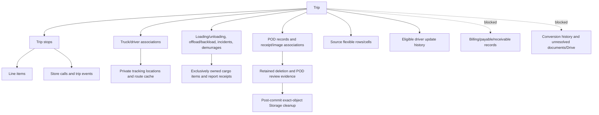

# Phase 2D.3 - Selection cleanup and safe bulk trip deletion

Date: October 19, 2026. Local implementation and isolated verification completed.
**Database-dependent legacy attachment resolution is pending approval.** No new
migration was applied to Supabase, and no live deletion was attempted.

## 1. Scope and worktree

The prior Phase 2D.1/2D.2 worktree was preserved. No authentication/session policy,
master data, table-design storage, normal editing lifecycle or report-only deletion
semantics were replaced. Runtime flags were not changed; the existing locally
enabled whole-trip feature remains as configured. Tracking, planned routes and PDF
were not enabled. The normal backend was not restarted to activate new code.

## 2. Root cause

The error is a PostgreSQL `55000` retention exception, not a password failure:

- Installed `delete_whole_trips_v1(uuid[],uuid)` rejects any selected trip with a
  nonblank `driver_trip_updates.pod_image_path` or `pod_image_url`.
- Installed `delete_transaction_with_cleanup_v1(uuid,uuid,uuid)` applies the same
  guard when deleting the final stop/empty parent.
- `preview_whole_trip_deletion_v1` reports the same generic legacy-POD blocker.
  Its existing counts include driver updates, receipts and images, but do not
  classify individual ownership findings or count distinct physical objects.
- The backend maps this exception to a protected conflict; no Storage cleanup starts
  when the relational transaction fails.

The current upload workflow itself writes these driver-history paths. It uploads
an immutable private receipt via `uploadTripImage`, records its exact trip/stop and
uploader in `trip_images`, then appends the same Storage path to driver history.
Receipt-only resubmission follows this pattern without changing delivery milestones.
Thus the blanket legacy guard also blocks modern, verifiable receipts. Driver
history has no `trip_stop_id`; its bare path was never sufficient evidence by itself.

The installed functions were not weakened or replaced on the live project.

## 3. Read-only Supabase findings

Backend and MCP configuration both identify project **hdmknewarynwpbrhfgai**.
Migration history still ends with the existing Operations reliability/terminal-guard
migrations. The new proposed helper/validator/guard functions are absent live.

Initial and final aggregate checks: **7 trips, 46 driver updates, 9 trip images,
0 pending transaction cleanup jobs**. Eight attachment-bearing driver updates span
five trips. All eight have:

- One exact matching `trip_images.storage_path`, with the same parent trip.
- A valid stop owned by that trip; any linked POD agrees on trip and stop.
- A recorded uploader matching the driver's profile and a matching assignment.
- An existing object in private `trip-images`, with image MIME metadata.
- No observed conflicting trip/image/driver reference or document/Drive/report
  receipt reference to that exact object.

Storage `owner_id` is NULL for these service-role uploads. This is not repaired or
invented: the proposal uses the authenticated database uploader, driver, assignment,
stop and provider-managed object metadata together. Filename spelling alone never
establishes ownership.

The standalone read-only classification SELECT returned **8 VERIFIED, 0 BLOCKED**.
This is an advisory ownership result, not permission to delete. All affected trips
currently had zero billing/payable/receivable, conversion-history, document/Drive
attachment or pending receipt-upload blockers in the inspected aggregates. The RPC
must recheck under locks at decision time; these observations can become stale.

### Exact inspected references (not a deletion target set)

| Driver update ID | Receipt ID |
|---|---|
| b8b3400f-a8d1-4ebe-bb8e-71714646e417 | 924b613c-2424-4273-8573-53e2f3389bf4 |
| 93fef422-f32a-48ea-a7cb-2d738bf4ca75 | 35217c69-9180-4103-9c33-66a51ee85c60 |
| ed8a9265-c998-4737-829b-a16a05111079 | 33d346eb-08d0-4817-99cc-252680f99772 |
| 14b387d2-d855-4f28-9a50-0c3de851d47f | ee2d2b95-7276-467e-82e9-4d00fabc9017 |
| 414fabdc-5ce7-4b4d-ab4d-0600e006f190 | b8ca7510-8731-41a0-80c5-2a127b560ee1 |
| 325eb191-0b6c-47a2-afd0-13b03b64476c | 62fa7830-7fb9-4ace-9921-0e3879b08d02 |
| 16efa60a-07da-449f-99bb-7720d3470398 | 8727b5e8-7a5d-4df4-a0ba-0e07191a7a2e |
| 9587c351-c983-40a1-8296-3c430603a4d1 | a2b02ab9-9bae-46ed-8c8c-ba785ce2fd14 |

The previously protected DR 333 receipt is included only in read-only inspection;
it was not changed, approved, rejected or deleted.

## 4. Dependency graph and retention

The existing central RPC remains the deletion authority:

The existing parent-FK and composite stop/report relationships remain in force.
Financial records are blockers, not deletion targets. Conversion history and
unresolved document/Drive references continue blocking. POD review events remain
retained. Shared customers, stores, products, drivers, trucks, warehouses and
trucking companies are not in the deletion allowlist; only their trip associations
are removed. Disposable fixtures cover the operational graph they model; the
simplified master-data sentinel does not reproduce every production master FK.

## 5. Frontend changes

- Removed the selected-row/unique-trip/current-page summary text from Combined and
  Tracker toolbars. No Clear Selection action was added. Checkboxes, highlighting,
  selection state, conditional actions and page-scoped behavior remain.
- Trips now exposes the same Admin whole-trip bulk action already used by Combined
  and Tracker. Exact physical `trip_id` selection is deduplicated, with a maximum
  of 20 unique parents. Missing/stale IDs and 21-parent selections fail closed.
- The existing stop/transaction action remains separate, with its own password and
  ownership protections; it is not silently converted into whole-trip deletion.
- All three parent-deletion entry points use the same service and shared dialog.
  The dialog distinguishes selected rows from unique parents, lists dispatches and
  dependency counts, and requires the current Admin's password. It displays exact
  blocked/verified POD findings when the proposed database response is available.
- Database and Storage results remain distinct. A confirmed relational deletion
  with failed/blocked file cleanup shows an explicit pending-cleanup warning.

## 6. Proposed database solution - approval required

File: `backend/migrations/2026_11_13_proposed_verified_trip_attachment_cleanup.sql`

SHA-256: **96E83021882FA5FD8FAF56452CA5E1813541140507B5805621EAA1B3CFD0245E**

This proposal changes no existing data at installation. It creates no ownership
backfill, new table, bucket, RLS policy or Realtime publication entry. It:

1. Checks the three existing RPC fingerprints and stops on unexpected definitions.
2. Adds a private ownership inspector that requires consistent receipt/stop/POD,
   driver/uploader/assignment and private Storage metadata. URL-only references,
   unsupported MIME/PDF, missing objects, conflicting owners and shared references
   remain blocked. Opaque URLs elsewhere are conservatively retained for review.
3. Replaces the generic legacy check in the three existing RPCs with this inspector,
   while retaining financial, history, receipt-reservation and other ownership guards.
4. Expands impact output with per-reference findings and distinct Storage-object,
   legacy-reference and pending-upload counts. It performs no cleanup.
5. Captures legacy ownership evidence before removing the first stop. Verified
   history is removed within the same whole-trip transaction and evidence is added
   to every relevant journal. This avoids losing the original stop/POD evidence
   through intermediate FK SET NULL operations. Direct partial-stop deletion with
   retained driver POD history is conservatively blocked.
6. Captures exact Storage IDs, version and metadata fingerprints in the existing
   cleanup manifest. No bytes are removed by SQL.
7. Adds a service-only, role-checked cleanup validator. It rejects retained references,
   replaced IDs, changed versions/metadata and unverified legacy manifests. Already
   removed objects permit idempotent retries.
8. Adds five narrow reference guards on trip images, report receipts, driver history,
   documents and Drive references. Retained journal tombstones prevent ordinary
   writes from reattaching objects already scheduled for deletion. Opaque/encoded
   references are conservatively blocked rather than interpreted as ownership.

Existing RPC owner/ACL behavior is preserved by CREATE OR REPLACE. New helper and
trigger functions are not executable by browser roles; only the cleanup validator
adds service-role execution. No general force-delete or skip-protected mode exists.

A separate read-only preview is supplied at:
`backend/scripts/2026_10_19_legacy_pod_ownership_preview.sql`.
The final proposal also blocks unregistered Storage objects in a trip namespace and missing-object receipt reservations. Namespace discovery is only a reason to block/review, never ownership evidence authorizing file removal. Objects already queued by an earlier stop journal are accepted only when their exact ID/version/metadata match that manifest. No such unregistered objects were found in the live read-only inspection.

No one-time data repair is proposed for the currently verifiable eight references.
Ambiguous future records must remain blocked and receive an evidence-based proposal
rather than an automatic metadata backfill.

### Rollback/recovery

Before approved schema rollback, stop the backend/deletion/cleanup consumers.
Restore the catalog-reviewed original three RPC definitions, drop only the five new
reference triggers and the three new helper/validator/guard functions. This itself
requires approval; do not drop journals or restore the old last-stop RPC without
its compatible parent-FK implementation. Keep all audit manifests and pending jobs.
The original live definitions and approved migration files remain unchanged in the
repository. No SQL rollback can restore physically deleted Storage bytes.

## 7. Relational and Storage lifecycle

Within PostgreSQL, the existing batch RPC takes its dependency locks, verifies
identity, authorization and ownership, and executes eligible operations in one
transaction. A failure anywhere rolls back every selected parent, child, audit
journal and cleanup reservation. The 20-trip cap remains unchanged.

After a confirmed database acknowledgement, the backend broadcasts stable trip
DELETE identities and starts journal-based file cleanup. New application code first
calls the proposed cleanup validator and checks every returned object against the
immutable manifest. No bucket listing, filename guessing or sibling deletion occurs.
Validation failure is persisted as a generic `last_error`, returned as blocked/pending
and remains recoverable. Storage failure leaves the journal pending. An acknowledgement
failure never produces a false COMPLETE result. Concurrent local retries share the
existing in-flight cleanup request; cross-worker retries target the same immutable
objects and are idempotent. COMPLETE is recorded only after successful cleanup and
journal acknowledgement.

This is recoverable eventual cleanup, **not cross-system atomicity**. There is still
a boundary between validation and the Storage API call. Normal uploads use new UUID
paths and `upsert:false`; journal reference guards and ID/version/metadata checking
protect ordinary workflow races. An out-of-band privileged Storage administrator
must not overwrite objects during cleanup; PostgreSQL cannot lock an external API
operation. No claim of protection against arbitrary privileged bypass is made.

Until the proposal is approved/applied, the installed RPC still blocks legacy POD
parents. New cleanup code also fails closed if its validator is missing: relational
acknowledgement may be confirmed for otherwise eligible records, but files stay
queued and the result reports pending verification. Do not deploy/restart the new
cleanup path before reviewing this installation dependency.

### Upload reservation race fix

A directly related image intake race was fixed locally: `uploadTripImage` now inserts the existing physical receipt/photo record before uploading bytes. Order lookup and validation happen first. A missing object therefore has durable owner metadata and blocks proposed deletion as an incomplete upload. Compensation removes only the exact new object, and removes its reservation only after Storage confirms cleanup. Upload/signed-link failure with failed compensation retains the reservation and returns a recovery error. Original receipts and milestones remain unchanged. The new tests assert reservation-before-upload and recovery evidence preservation; the prior receipt-only resubmission test still passes. This uses existing columns and needs no additional schema.

## 8. Authorization, audit and Realtime

Existing Supabase password verification, request-local nonpersistent Auth client,
immutable batch binding, session rechecks and Redis/local confirmation limiter are
reused. STAFF/TRUCKER do not gain whole-trip privileges. Report-only deletion and
its own-role permissions remain unchanged. No passwords were entered against a live
deletion endpoint in this phase.

A committed, complete RPC acknowledgement is required before management Socket.IO
DELETE broadcasts; failures emit nothing. Event IDs match the existing durable
bridge, so overlapping Socket/Supabase signals deduplicate. The frontend removes
matching parent rows by physical ID and preserves unrelated local drafts. A draft
on the deleted parent is retained for deferred reconciliation instead of silently
being discarded. Relevant caches (Trips/reports/Tracker/dashboard/tracking/driver/
flex/calendar/documents) are invalidated through existing mechanisms. Pagination
and totals reconcile in the background. No full-page reload is required.

Existing Supabase publication includes trips/stops/line items and relevant report
sources plus `admin_change_signals`; private journals are not newly published.
No publication change is required.

## 9. Verification

- Full backend suite: **212/212 passed**, zero failed/skipped. Final focused
  ownership/deletion rerun: **9/9 passed**; reservation/resubmission rerun: **5/5 passed** (overlapping tests, not additional unique cases).
- Full frontend suite: **99/99 passed**, zero failed/skipped.
- Frontend/backend TypeScript and production builds passed.
- Targeted changed-file frontend lint passed except the two pre-existing Tracker
  findings (`no-control-regex`, `set-state-in-effect`), already reproduced from HEAD
  in Phase 2D.2. No new lint errors were introduced.
- Existing Vite chunk-size/build plugin timing warnings remain; no unrelated build
  refactor was attempted. `git diff --check` passed with existing newline warnings.
- New SQL proposal installed only into disposable PostgreSQL 18 at loopback port
  55447. Installation preserved content hashes of **12 modeled tables**, including
  operational fixtures, journals, audit events and Storage metadata.
- **31 disposable SQL cases passed**, including multi-stop ownership, URL ambiguity,
  missing receipts, uploader/assignment/Storage/POD inconsistencies, MIME protection,
  shared references, financial and conversion retention, pending uploads, atomic
  rollback, duplicate parents/retries, unrelated trips, 20/21 boundaries, roles,
  partial-stop retention, immutable manifests, replacement IDs and same-ID metadata
  changes, missing-object retry, tombstones and private grants. Two independent
  sessions verify concurrent duplicate deletion and concurrent driver mutation.

### 15 unique isolated browser fixtures passed

`trips-bulk-deletion`, `trip-deletion-realtime`, `tracker-trip-deletion`,
`report-wizard`, `whole-trip-password`, `operations-table`,
`operations-pagination`, `admin-realtime`, `live-cell-drafts`,
`live-tracker-drafts`, `live-operations-drafts`, `shared-design`,
`trip-details-column`, `loading-time`, `users-one-load`.

The new Trips fixture verifies blocked receipt details, checkbox deduplication,
selected-row versus parent counts, password failure, double-submit protection,
explicit pending-cleanup toast and STAFF denial. The new two-context actual Socket
fixture removes sibling rows while preserving an unrelated typed draft. Existing
fixtures cover report-only deletion, cross-session refresh, resize/draft protection,
loading timestamps and unchanged live typing (zero typing/cancel save requests).
All successful deletion and file-removal tests used mocks or disposable metadata;
none used Supabase business data or actual production files.

Initial fixture failures were corrected without weakening safety assertions: the
replacement test initially selected a report-only journal rather than its image
journal; a later concurrent writer was intentionally stopped by the new opaque-URL
tombstone guard, so the race test now uses a permitted canonical-path mutation and
verifies revalidation under lock. The new unregistered-object guard initially mistook an earlier stop's already-journaled object for an orphan; it now recognizes only exact immutable manifest matches, and the full multi-stop cases pass. Final versions pass.

## 10. Files changed in this phase

Backend production:
- `src/services/whole-trip-deletion.service.ts`
- `src/services/transaction-deletion.service.ts`
- `src/services/trip-image.service.ts`

Frontend production:
- `src/components/admin/ReportDataView.tsx`
- `src/components/admin/TransmittalTrackerView.tsx`
- `src/components/admin/WholeTripDeletionDialog.tsx`
- `src/components/admin/useSpreadsheetCollaboration.tsx`
- `src/services/whole-trip-deletion.ts`
- `src/services/realtime.service.ts`

Proposal/read-only script:
- `backend/migrations/2026_11_13_proposed_verified_trip_attachment_cleanup.sql`
- `backend/scripts/2026_10_19_legacy_pod_ownership_preview.sql`

Tests:
- `backend/tests/safe-trip-attachments.test.ts` (new)
- `backend/tests/transaction-deletion.test.ts`, `whole-trip-deletion.test.ts`,
  `pod-resubmission.test.ts`
- `backend/tests/fixtures/setup-safe-trip-attachments-2d3.cjs` (new)
- `backend/tests/fixtures/safe-trip-attachments-2d3.cjs` (new)
- `backend/tests/fixtures/collaboration-browser-server.ts`
- `frontend/tests/trips-bulk-deletion.browser.js` (new)
- `frontend/tests/trip-deletion-realtime.browser.js` (new)
- `frontend/tests/tracker-trip-deletion.browser.js`, `report-wizard.browser.js`

Docs: this report and the main progress checkpoint. Other worktree changes predate
this phase and were preserved.

## 11. Required approval and remaining acceptance

### Installation addendum — October 19, 2026

The owner subsequently authorized this exact final file and application-driven
Admin deletion of eligible existing trips. Migration **20261019053739**
(`verified_trip_attachment_cleanup`) was applied once through Supabase MCP to
project `hdmknewarynwpbrhfgai`.

Verified SHA-256 before and after installation:
`96E83021882FA5FD8FAF56452CA5E1813541140507B5805621EAA1B3CFD0245E`.
Backend configuration and connected MCP project matched; all three prerequisite
RPC fingerprints matched. The six installed function bodies match the approved
file after CRLF normalization. Five attachment-reference guard triggers are
enabled. Deletion/preview/cleanup RPCs remain service-only; ownership and trigger
helpers have owner-only execution. No RLS, publication or Storage policy changes
were included. Both receipt buckets remain private with the 5 MB limit.

Before/after checked live counts were identical: 9 trips, 10 stops, 11 line items,
47 driver updates, 9 images, 1 POD and 42 Storage objects; zero orphan driver
updates. No production deletion RPC or Storage cleanup was executed.

The local flag was already `WHOLE_TRIP_DELETE_ENABLED=true`. The local backend
was restarted with the existing configuration after installation; health passed.
An authenticated read-only capability request through the application's API
client confirmed `enabled:true`, `max_unique_trips:20`, `password_required:true`.
A raw bearer-only probe returned 401 because it omitted the application's session
context; the standard application client succeeded. This is not destructive live
acceptance. Actual deletion must be initiated by an authenticated Admin.

Fresh verification: backend **212/212**, frontend **99/99**, disposable PostgreSQL
**31/31**, and **3/3** isolated browser fixtures (Trips bulk deletion, Tracker
deletion and password dialog) passed. Disposable migration installation preserved
content hashes across 12 modeled tables. Backend/frontend builds and TypeScript
passed; frontend retains its existing large-chunk warning. The initial frontend
test invocation used the wrong TSX configuration (8 JSX failures); rerunning with
`TSX_TSCONFIG_PATH=tsconfig.app.json` passed all 99 without application changes.
Backend targeted ESLint could not run because no backend ESLint configuration is
provided; no backend source was changed by this installation. `git diff --check`
passed. The local worker reports one process, with the existing in-process
confirmation limiter; multiple workers still require shared Redis and fail closed
without it.

No trips or attachments were selected for production deletion, no operational
data removal, deployment, commit or push occurred. GPS, planned provider routing
and PDF intake were not enabled. The earlier pending-approval list below is the
historical pre-installation checkpoint; the migration and local runtime gate are
now satisfied. Real Storage failure/recovery remains verified with isolated mocks,
not a production deletion exercise.

1. Review and separately approve the exact proposed migration/checksum above.
2. Before application, repeat project/fingerprint/schema/privilege checks; apply
   nothing if those differ. Apply only after approval, then verify ACLs, trigger
   scope and data preservation read-only.
3. Restart the local backend with the new code only after its cleanup validator is
   available; preserve existing feature/security configuration.
4. Live authenticated UI acceptance and an explicitly designated disposable
   deletion/file-cleanup scope remain separate. No production trip is authorized
   as a destructive acceptance fixture by this report. DR 333 remains untouched.

No production ownership repair, Storage-policy, RLS or publication change is
requested. Real Storage failure/recovery and multi-worker load behavior were tested
with mocks, not a live provider or deployed replicas. The tombstone scan prioritizes
safety; its performance at a large accumulated journal volume remains unmeasured.

**Safety:** no live migration, INSERT/UPDATE/DELETE, operational removal, Storage
upload/deletion, GPS capture, Directions/Gemini request, feature-flag change,
deployment, commit or push occurred. Only read-only live inspection was performed.
